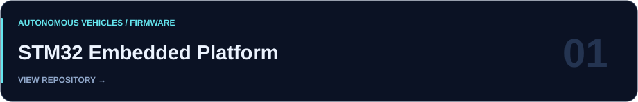
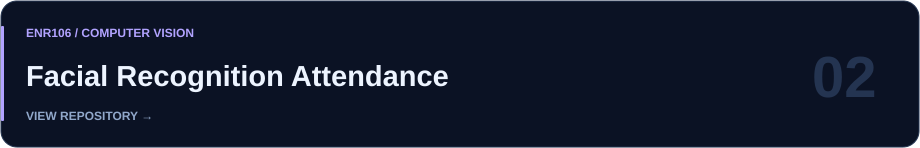
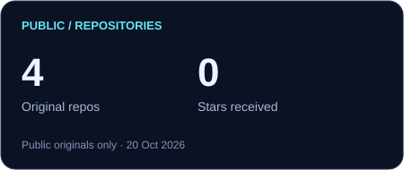
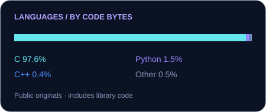
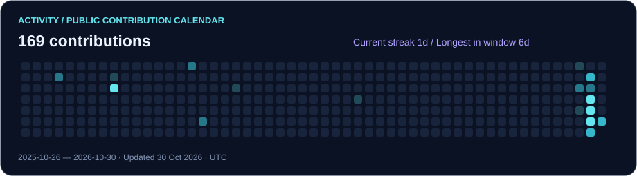

<h1 align="center">Hi, I'm Diyan Patel.</h1>

<strong>Electronics · Firmware · Software</strong>

  Electrical & Electronics Engineering student at <strong>Ahmedabad University</strong>. 
  Exploring how electronics, firmware, and software come together in systems that move, sense, and respond.

  

  <a href="#selected-work">Selected work</a> &nbsp; / &nbsp;
  <a href="#engineering-toolkit">Engineering toolkit</a> &nbsp; / &nbsp;
  <a href="#development-activity">Development activity</a> &nbsp; / &nbsp;
  <a href="https://github.com/diyan07-ctrl?tab=repositories">All repositories ↗</a>

## About me

I'm interested in the connection between code and the physical world: microcontrollers, sensors, hardware integration, and autonomous vehicles. My public work spans STM32 firmware and a Python computer-vision application.

- **Embedded engineering:** working with STM32, FreeRTOS, sensor interfaces, and actuator control.
- **Software development:** building a facial-recognition attendance application with Python and OpenCV.
- **Exploring:** robotics, autonomous systems, and the electronics behind them.

## Selected work

Firmware for an STM32F401RE autonomous-vehicle controller, with modules for CAN communication, IMU and ultrasonic sensing, PWM control, and safety handling.

**C · STM32 · FreeRTOS · CAN · I²C · SPI · UART** &nbsp; [Explore the firmware ↗](https://github.com/diyan07-ctrl/Stm32embeddedplatform)

 

An ENR106 academic project that brings together face registration, recognition, a graphical interface, and class and attendance management.

**Python · OpenCV · Tkinter · CSV** &nbsp; [Explore the application ↗](https://github.com/diyan07-ctrl/ENR106-Facial-Recognition-Attendance-System)

## Engineering toolkit

**Languages**

 

**Embedded systems**

  

**Computer vision & interfaces**

 

**Hardware interfaces:** CAN bus · I²C · SPI · UART · PWM 
**Development:** Git · GitHub

## Development activity

  
  

  

Cards refresh daily from public GitHub data. Language share measures repository bytes, including checked-in libraries; it does not measure proficiency. Activity follows GitHub's public contribution calendar and UTC dates.

## Connect

Interested in embedded systems, robotics, or computer vision? Find my work and start a project discussion on [GitHub](https://github.com/diyan07-ctrl).

  

