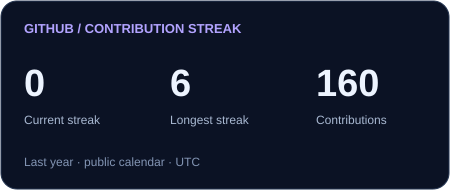

# Diyan Patel

I'm an Electrical and Electronics Engineering student at Ahmedabad University, interested in embedded systems, robotics, and autonomous vehicles. 
## What I work with

<table>
<tr>
<td width="60%" valign="middle">

<strong>Core</strong> &nbsp; &nbsp; &nbsp; &nbsp; &nbsp; 

<strong>Also work with</strong> &nbsp; &nbsp; 

</td>
<td width="40%" valign="middle" align="center">

</td>
</tr>
</table>

## GitHub Statistics

  
  

  

