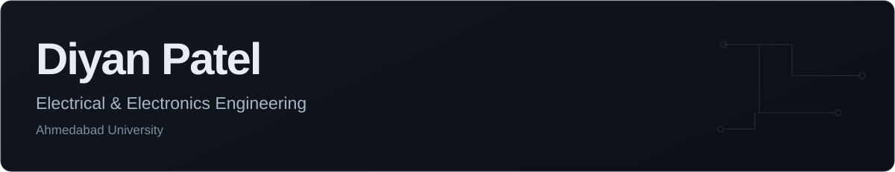
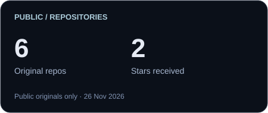
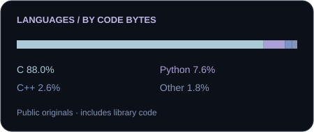

<picture>
  <source media="(max-width: 600px)" srcset="assets/profile-header-mobile.svg">
  
</picture>

I'm an Electrical and Electronics Engineering student at Ahmedabad University.
I write C/C++ firmware for STM32 and ESP32 boards and use Python for computer vision and desktop tools. I'm interested in robotics and autonomous vehicles.

[Repositories](https://github.com/diyan07-ctrl?tab=repositories) · [LinkedIn](https://www.linkedin.com/in/diyan-patel-83a09337b/) · [GitHub activity](#github-activity)

### Skills

| Area | Technologies |
| :--- | :--- |
| Languages | C, C++, Python |
| Hardware | STM32, ESP32, Raspberry Pi, Arduino |
| Embedded software | FreeRTOS, CAN, ESP-NOW, sensor interfaces, motor control |
| Vision and desktop | OpenCV, Tkinter |
| Tools | STM32CubeIDE, Git, GitHub |

### GitHub activity

  
  

Public activity and language statistics refresh every hour.
