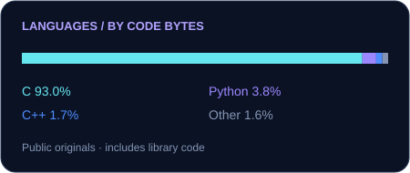
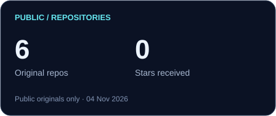
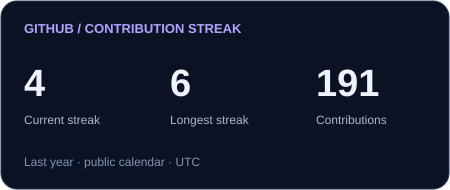

# Diyan Patel

I'm an Electrical and Electronics Engineering student at Ahmedabad University, working on embedded systems, robotics, autonomous vehicles, and computer vision. My projects combine microcontroller firmware, robot control, and camera-based applications.

## What I work with

<table>
<tr>
<td width="60%" valign="middle">

<strong>Core</strong> &nbsp; &nbsp; &nbsp; &nbsp; &nbsp; 

<strong>Also work with</strong> &nbsp; &nbsp; 

<strong>Robotics &amp; control</strong> ESP32 &middot; Raspberry Pi &middot; Arduino &middot; C++ &middot; ESP-NOW &middot; CAN

</td>
<td width="40%" valign="middle" align="center">

</td>
</tr>
</table>

## Projects

### [Quadruped107](https://github.com/diyan07-ctrl/Quadruped107)

An eight-servo quadruped software port using a **Raspberry Pi 4**, **Pi camera**, and **Arduino Uno R3**. The Pi handles browser controls, video, and blue-ball tracking; the Uno executes gait sequences through a PCA9685 over a USB serial link. Includes stop handling, connection watchdogs, CAD assets, and setup documentation. Physical hardware validation and gait calibration remain in progress.

**Stack:** Python · C++ · Raspberry Pi · Arduino · Picamera2 · OpenCV · Flask

### [ESP32 Gesture-Controlled Drone](https://github.com/diyan07-ctrl/esp32-gesture-controlled-drone)

An experimental quadcopter controller and gesture glove built around two **ESP32 boards**, **MPU6500 IMUs**, and **ESP-NOW** communication. Includes flex-sensor calibration, attitude estimation, PID control, motor mixing, and failsafe logic. Hardware and flight validation remain separate from the software tests.

**Stack:** C++ · ESP32 · ESP-NOW · PlatformIO · Python

### [STM32 Embedded Platform](https://github.com/diyan07-ctrl/Stm32embeddedplatform)

Embedded firmware for a **BFMC 2026 autonomous vehicle controller** using an **STM32F401RE** and **FreeRTOS**. Covers CAN communication with a companion computer, sensor interfaces, steering and drive PWM, and watchdog-based safety handling.

**Stack:** C++ · STM32 · FreeRTOS · CAN · STM32CubeIDE

### [Facial Recognition Attendance System](https://github.com/diyan07-ctrl/ENR106-Facial-Recognition-Attendance-System)

A Python computer-vision application developed for **ENR106 at Ahmedabad University**. Supports face registration and recognition, a graphical interface, user and class management, and attendance records.

**Stack:** Python · OpenCV · Tkinter · CSV

[Earlier attendance-system repository](https://github.com/diyan07-ctrl/Face-Recognition-Attendance-system) · [All repositories](https://github.com/diyan07-ctrl?tab=repositories)

## GitHub Statistics

  
  

  

