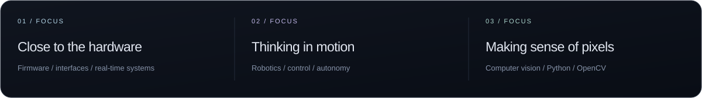
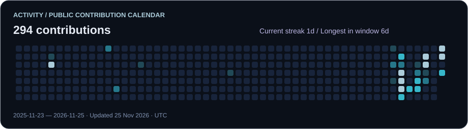
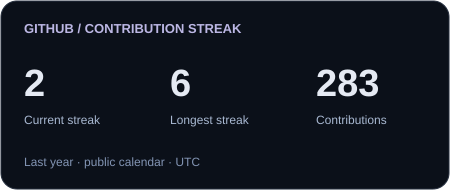
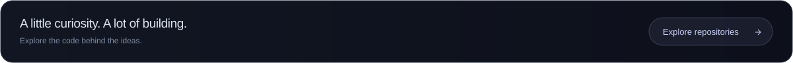

  <picture>
    <source media="(max-width: 600px)" srcset="assets/banner-mobile.svg">
    
  </picture>

  <a href="#about">About</a> &nbsp; / &nbsp;
  <a href="#toolkit">Toolkit</a> &nbsp; / &nbsp;
  <a href="#activity">Activity</a> &nbsp; / &nbsp;
  <a href="https://github.com/diyan07-ctrl?tab=repositories">Explore code ↗</a>

 

### About

I'm **Diyan**, an Electrical and Electronics Engineering student at **Ahmedabad University**.
I work where electronics meets software: microcontroller firmware, robot control, autonomous vehicles, and camera-based applications.

 

  <picture>
    <source media="(max-width: 600px)" srcset="assets/focus-mobile.svg">
    
  </picture>

 

### Toolkit

<strong>Open the workbench</strong> &nbsp; · &nbsp; Languages, hardware and tools

 

| Layer | What I work with |
| :--- | :--- |
| Languages | C · C++ · Python |
| Embedded | STM32 · ESP32 · FreeRTOS · CAN · ESP-NOW |
| Robotics | Raspberry Pi · Arduino · Sensor interfaces · Motor control |
| Vision & interfaces | OpenCV · Tkinter |
| Development | STM32CubeIDE · Git · GitHub |

### Activity

<strong>A look behind the commits</strong> &nbsp; · &nbsp; Public GitHub activity, refreshed hourly

 

  
  

  

  

Public data only. Scheduled hourly; the timestamp shows the last successful refresh.

 

<a href="https://github.com/diyan07-ctrl?tab=repositories">
  <picture>
    <source media="(max-width: 600px)" srcset="assets/footer-mobile.svg">
    
  </picture>
</a>
